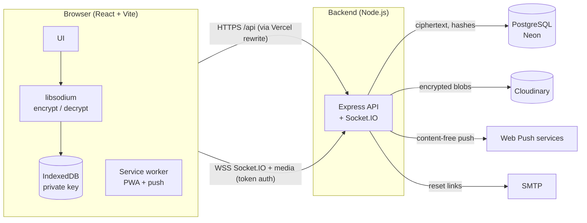

# Private Chat

A private, invite-only, **end-to-end encrypted** chat web app for a small circle of friends and family.
Messages, photos, videos, voice notes and reactions are encrypted in the browser — the server only ever
stores ciphertext.

> 📸 **Screenshots** — add yours here:
> `docs/screenshots/login.png` · `docs/screenshots/chat-light.png` · `docs/screenshots/chat-dark.png` · `docs/screenshots/mobile.png`

## Features

**Messaging**
- 1-to-1 real-time chat (Socket.IO): delivered ✓✓ / read receipts, typing indicator, online status & last seen
- Offline delivery, paginated history, unread counts, optimistic sending with retry
- Replies (quoted), emoji reactions, delete for everyone, disappearing messages (1 h / 24 h / 7 days)
- Photos & videos (drag & drop, paste, picker) with captions and a full-screen viewer
- Voice notes with waveform
- Emoji picker, big-emoji messages, clickable links, per-chat bubble colors

**Privacy & security**
- End-to-end encryption (libsodium: X25519 + XChaCha20-Poly1305) for text, media, voice and reactions
- Photos are re-encoded in the browser → EXIF metadata (GPS location, camera) removed before upload
- Safety numbers + QR code to verify contacts; warning when a contact's key changes
- Encrypted key backup with a passphrase (Argon2id) to restore on a new device
- Invite-only signup; invites also connect people (chats only start with consent)
- Disconnect ("unfollow"): chat becomes read-only for both
- Argon2id passwords, short-lived JWTs + rotating httpOnly refresh cookie, rate limiting, strict CSP

**App**
- Professional light & dark themes, responsive (desktop two-pane, mobile single-pane)
- Installable PWA, push notifications that never contain message content
- Password reset by email, recovery email & key backup in Settings, "Get started" checklist

## Architecture



| Folder | What it is |
|---|---|
| `server/` | Node.js + Express 5 + Socket.IO API, PostgreSQL (`pg`), migrations in `server/migrations/` |
| `client/` | React 19 + Vite + Tailwind CSS 4 web app, React Router |
| `DEPLOY.md` | Step-by-step deployment (Neon + Render + Vercel + Cloudinary) |

## Run locally

Prerequisites: Node 22+, PostgreSQL 14+ running locally.

```bash
cd server
npm install
cp .env.example .env      # set DATABASE_URL and JWT_ACCESS_SECRET (see comments inside)
npm run migrate up        # create the tables
npm run invite            # print a one-time invite code for the first user
npm run dev               # http://localhost:3000
```

```bash
cd client
npm install
npm run dev               # http://localhost:5173
```

Open http://localhost:5173 and register with the invite code. Vite forwards `/api` and `/socket.io` to the server.

### Useful commands

| Where | Command | What it does |
|---|---|---|
| server | `npm run invite -- 3` | One-time invite valid for 3 days |
| server | `npm run test-email -- you@example.com` | Checks the SMTP settings |
| server | `npm run vapid` | Generates keys for push notifications |
| server | `npm run migrate up` / `down` | Apply / undo database migrations |
| server | `npm run check` | Syntax-checks every server file (used by CI) |
| client | `npm run build` / `npm run preview` | Production build / serve it locally with the production CSP |

Configuration lives in `server/.env` (see `server/.env.example`) and `client/.env.example`.
Locally, without SMTP or Cloudinary, reset links are printed in the server terminal and media is stored in `server/uploads/`.

## Security design

### End-to-end encryption (E2EE)

| Piece | How |
|---|---|
| Library | libsodium (WebAssembly). No home-made crypto. |
| Identity keys | One X25519 key pair per account, generated **in the browser**. The private key is stored in IndexedDB and never sent to the server. Only the public key is uploaded. |
| Chat key | `BLAKE2b(context ‖ X25519(myPrivate, theirPublic) ‖ sortedPublicKeys)`: both people compute the same 32-byte key; the server cannot. |
| Messages | XChaCha20-Poly1305 with a random 24-byte nonce per message. Associated data = `chatId|senderId`, so a ciphertext can't be moved to another chat or re-attributed to another sender. Stored as `e2ee:v1:<nonce>:<ciphertext>`. The kind of message (text/photo/voice), captions and reply quotes are *inside* the ciphertext. |
| Media | Each file gets its own random key; the file is encrypted with XChaCha20-Poly1305 before upload, and the key travels inside the encrypted message. Photos are re-encoded on a canvas first, which strips EXIF metadata. |
| Reactions | Encrypted like messages, bound to the message id. |
| Server rule | The server **rejects** any message or reaction that isn't in the encrypted format. |
| Verification | A 60-digit **safety number** (hash of both public keys) + QR code. Compared in person/on a call; contacts can be marked verified, and key changes trigger a warning. |
| Key backup | Optional. The private key is encrypted in the browser with a **backup passphrase** (Argon2id 64 MB × 3 → XChaCha20-Poly1305). The server can't open it; a new device unlocks it with the passphrase. |

### Accounts, sessions, web security

- Invite-only signup (single-use codes, stored hashed). Passwords hashed with argon2id.
- 15-minute JWT access tokens kept in memory; 30-day refresh tokens in an httpOnly, SameSite cookie,
  stored hashed, rotated on every use, with reuse detection (a reused token logs out all sessions).
- Socket.IO connections authenticate with the JWT; the token is re-checked on every event.
- Rate limiting (failed logins, invites, resets, uploads, socket events), zod validation, helmet, strict CORS.
- Strict Content-Security-Policy in production (no inline scripts, only own origin + the API).
- Password reset via a single-use, 30-minute, hashed email link; resetting logs out every device.
- Push notifications contain no message text or sender name.
- Production start refuses unsafe settings (missing/HTTP CORS origin, placeholder secrets).

## Threat model

**What it protects against**

- A curious or compromised **database or server operator** reading messages or media: they only see ciphertext.
- Someone who steals a **database or Cloudinary backup**: messages, files, invite codes, sessions and reset
  tokens are all encrypted or hashed.
- A server that **swaps keys** to read messages (man-in-the-middle): detectable by comparing safety numbers.
- Tampering with messages/files in transit or storage: the Poly1305 tag fails and the content isn't shown.
- Location leaks through photos: EXIF metadata is removed before upload.

**What it does NOT protect against — read this**

1. **The web E2EE limitation (most important).** In a web app, the server delivers the JavaScript that does the
   encryption *every time you open the page*. A malicious or hacked server could send modified JavaScript that
   quietly leaks your private key or messages. Native apps reduce this risk because their code is signed and
   reviewed by app stores. Mitigations here: HTTPS, a strict Content-Security-Policy, open-source code anyone can
   audit, and the installed PWA. **The server operator is trusted not to serve malicious code.**
2. **Metadata is visible to the server:** who talks to whom, when, how often, approximate message/file sizes,
   IP addresses, online status, read/delivered times, typing, and when reactions/deletions happen.
3. **No forward secrecy:** chat keys come from long-term identity keys (no Signal-style "double ratchet").
   Someone who steals a private key can decrypt past messages they recorded.
4. **A compromised device** (malware, extensions, an unlocked laptop) can read everything, including the
   private key in IndexedDB. XSS would too — React's escaping, no `dangerouslySetInnerHTML` and the CSP help.
5. **Weak backup passphrases** can be guessed offline by someone who steals the backup. Use a long passphrase.
6. **Losing your key** (cleared browser data + no backup / forgotten passphrase) makes old messages unreadable.
7. **Videos keep their metadata** (only photos are re-encoded). Voice notes are recorded fresh, so they have none.
8. **"Delete for everyone" and disappearing messages** remove data from the server, but can't erase copies the
   other person already saved (screenshots, downloads).
9. **Messages sent before E2EE was added** are stored in plain text and shown with an 🔓 icon.

## Deployment

See **[DEPLOY.md](DEPLOY.md)**.

## Roadmap / not built yet

- Small group chats (needs per-member key distribution)
- Shared media album per chat
- Forward secrecy (double ratchet)
- Redis adapter for running several backend instances
- Automated test suite in the repo (the features were tested with scripts during development)
